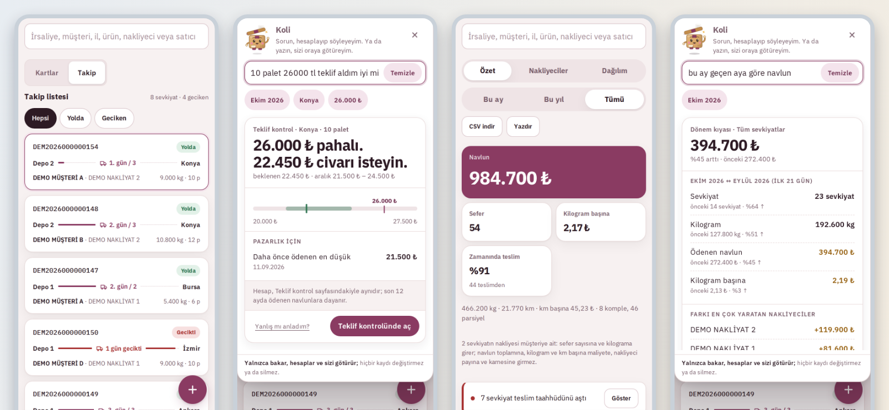

# Sevkiyat Defteri: a shipment logbook web app (case study)

A web app that a small trading company uses to track every delivery: what is on the road, which carrier is late, what a fair price looks like, and an email when a trip is done.

**Read the full case study: https://mkemalkahraman.github.io/sevkiyatdefteri-case-study/**

## At a glance

- Web app that installs from the browser and runs on a phone home screen
- React 19, TypeScript (strict), Vite, Supabase (Postgres, Auth, Realtime, Storage), Vercel
- 1,136 automated tests, and the build stops when one fails
- 25 database tables, every one with row-level security; secret keys exist only on the server
- 43 database migrations and 165 logged versions in about ten weeks
- A rules-only assistant (no language model) answers questions from the recorded data

## What it does

- **Open jobs:** every trip on the road as a card with a route line, late trips marked
- **Quotes:** carrier quotes compared with what was paid before on the same route
- **Analysis:** freight total, change against last month, cost per kilogram, carrier ranking
- **Assistant:** ask in plain Turkish; answers come from the recorded data and never change it
- **Emails:** delivery notes, supplier due-date reminders and weekly backups, sent once each

## Lessons from real bugs

- **The page that sometimes did not open:** network requests had no time limit, so a weak connection could hang the loading screen forever. Every request now has one.
- **The security fix that slowed every read:** a permission check ran once per row. Wrapping it brought reads from 432 ms back to 5 ms. Now every SQL change is timed.
- **One truck, two delivery notes:** a price split by hand made each part look like a cheap trip. The price is now typed once and split by weight.
- **The safety net that quietly stopped working:** an end-to-end test failed on its first line for several versions and nobody noticed. A check nobody runs is not a check.
- **One box, two meanings:** an empty delivery promise was saved as 0, which also meant "same day", and three screens measured lateness three ways. The rule now lives in one place and counts calendar days.

The full write-up is on the [case study page](https://mkemalkahraman.github.io/sevkiyatdefteri-case-study/#lessons).

## About this repository

- **No source code is published here.** This is a case study only.
- **All screenshots use invented data.** Customers, carriers, products, amounts and delivery note numbers are made up for this page.
- The app's interface is in Turkish because it was built for a Turkish company. The labels are explained next to each screen.

## Credit

Built with Claude as a pair programmer. Product decisions, business rules and testing on real phones are Kemal's.
